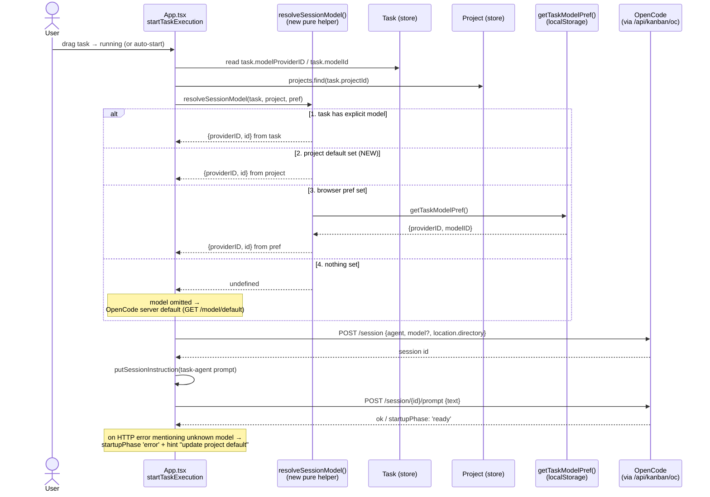

# Concept and Design — Project Model Selection

## Problem

Model choice today exists only at the *task* level (`Task.modelId` / `Task.modelProviderID`, picked in
`TaskModal` / `MobileTaskForm`) and as a browser-wide localStorage default (`getTaskModelPref()`).
The `Project` entity has no model at all, so:

- Every new task starts from the global default, not from the model that fits the project.
- A model choice is invisible in project settings and not shared between browsers/users.
- The assistant's per-project model pref (`readAssistantModelPref`) silently degrades to the
  global pref, so two projects using different models cannot coexist portably.

Users want: **when editing a project, pick the provider's model (from the OpenCode model list)
that this project's tasks and assistant should use by default.**

## Goals

1. `Project` carries a server-stored default model (`modelProviderID` + `modelId`), selectable in
   Project settings from the live provider model list.
2. One documented resolution order for "which model runs this session", implemented once and
   reused by task execution, task creation, and the assistant.
3. Task-level and per-chat overrides keep working — the project value is a *default*, not a lock.
4. Works on desktop and mobile project forms; degrades cleanly when the model list cannot load.

## Non-Goals

- No API-key / credential management — OpenCode owns providers (`GET /api/model` is read-only here).
- No per-agent model overrides, no per-task model locking, no cost/rate configuration (phase 2).
- No migration of already-created tasks: existing `task.modelId` values stay untouched.

## Model Source

`GET /api/kanban/oc/model` → `Model.Info[]` already fetched by `fetchModels()` (`src/api/opencode.ts`),
which dedupes `providerID/modelID` and sorts. The picker groups by `providerID`.
`GET /api/kanban/oc/model/default` (documented in `docs/OPENCODE_V2_ENDPOINTS.md`) supplies the
label for the "server default" option. Nothing new is needed on the OpenCode side.

## Data Model

`Project` (`src/types.ts`):

```ts
export interface Project {
  // …existing fields…
  /** Default model for new tasks/sessions in this project. Both halves or neither. */
  modelId?: string | null;        // "gemma4:e2b"
  modelProviderID?: string | null; // "ollama"
}
```

Invariant: `modelId` and `modelProviderID` are set together or both `NULL`
(a half-filled pair is invalid — same rule `createSession` already enforces).

Storage — `server/kanban.py`:

- `projects` table gains `model_id TEXT`, `model_provider_id TEXT`.
- Backfill `ALTER TABLE projects ADD COLUMN …` in `get_conn()` next to the existing
  `agent_ids` / `folder` / `git_url` / `git_branch` backfills (old DBs must keep opening).
- `row_to_project()` returns `modelId` / `modelProviderID`.
- `project create --model-id M --model-provider P` and `project update … --model-id/--model-provider`
  (`cmd_project_create` / `cmd_project_update`, mirroring the `agent_ids` handling;
  `project update` must not hit the "Nothing to update." branch when only the model changes).

Proxy — `vite.config.js`: pass `b.modelId` / `b.modelProviderID` as `--model-id` / `--model-provider`
in both the `POST /api/kanban/projects` and `PATCH /api/kanban/projects/:id` handlers
(alongside `--git-branch`, lines ~945 / ~960).

API docs — `docs/KANBAN_API.md`: add the two fields to the project create/update bodies and the
`GET /projects` example payload.

## Resolution Order (single source of truth)

New pure helper (desktop + mobile share it), e.g. `resolveSessionModel()` in
`src/store/serverConfig.ts` or a new `src/store/modelResolution.ts`:

```
1. task.modelProviderID + task.modelId      — explicit per-task pick (never overridden)
2. project.modelProviderID + project.modelId — project default (NEW)
3. getTaskModelPref()                       — browser-wide localStorage default
4. undefined                                — OpenCode server default
```

Consumers:

| Consumer | Today | After |
|---|---|---|
| `App.tsx startTaskExecution` (session create) | task → global pref → omit | task → **project** → global pref → omit |
| `src/mobile/useBoardData.ts` start path | same | same change |
| `TaskModal` / `MobileTaskForm` initial value | global pref | **project model** → global pref |
| `assistantSession.readAssistantModelPref(projectId)` | global pref fallback | **project model** → global pref |
| `SessionChatWindow` / `MobileChat` hint | task → nothing | task → **project model** |

The project object is already resolved in `startTaskExecution` (`projects.find(...)`), so the
change is local: pass `project` into the resolver instead of only `getTaskModelPref()`.

## Sequence Diagrams

### 1. Select and save the project's model (Project settings)

```mermaid
sequenceDiagram
    actor U as User
    participant PM as ProjectModal /<br/>MobileMenu
    participant UF as useProjectForm
    participant OC as fetchModels()<br/>(src/api/opencode.ts)
    participant PX as Vite proxy<br/>/api/kanban
    participant CLI as server/kanban.py<br/>(project create/update)
    participant DB as SQLite<br/>projects table

    U->>PM: Open "Edit Project"
    PM->>UF: reset(project) + loadRoots()
    PM->>UF: loadModels()
    UF->>OC: fetchModels()
    OC->>PX: GET /api/kanban/oc/model
    PX->>OC: Model.Info[] (deduped, sorted)
    OC-->>UF: [{providerID, modelID}, …]
    UF-->>PM: providers (grouped) + models per provider

    U->>PM: pick provider "ollama" + model "gemma4:e2b"<br/>(or "Server default" → clears both)
    PM->>UF: toData() incl. modelId + modelProviderID
    PM->>U: onSave(data)
    U->>PX: PATCH /api/kanban/projects/:id<br/>{modelId, modelProviderID}
    PX->>CLI: project update <id> --model-id … --model-provider …
    CLI->>DB: UPDATE projects SET model_id, model_provider_id
    Note over CLI: guard: both halves set or both NULL;<br/>never "Nothing to update." for a model-only change
    DB-->>CLI: ok
    CLI-->>PX: row_to_project() → Project{modelId, modelProviderID}
    PX-->>U: Project (updated)
    PM-->>U: modal closes, project pill shows "ollama/gemma4:e2b"
```

### 2. Task starts — resolution order picks the model



## UI

### ProjectModal (desktop) / MobileMenu project form

New "Model" block after Description, following the existing Git block styling:

- Header row: `Model` + refresh button (re-runs `fetchModels()`), same pattern as the folder refresh.
- Two grouped selects: `providerID` list, then that provider's `modelID` list.
- First option in the provider select: `Server default` → clears both fields.
- Selected value rendered `providerID/modelID` in mono, exactly like task selects.
- State lives in `useProjectForm` (`selectedModel`, `loadModels()`, included in `toData()`),
  so `ProjectModal` and `MobileMenu` get it without duplicated logic.

### Surfaces that show the effective default

- Project settings header / project selector: small `· ollama/gemma4:e2b` pill, or `default` when unset.
- `TaskCard` unchanged (it already shows the *task's* model once set).
- `AssistantChatWindow` status line: shows `project model` when the assistant pref is unset
  but the project has one (today it prints `server default`, which becomes misleading).

## Error Handling & Edge Cases

- **Model list unavailable** (server offline / proxy down): render the block with a muted
  "model list unavailable" note + refresh; keep the stored value visible and editable-by-clear only.
  Never wipe a stored model because fetch failed.
- **Stale model** (selected model removed from the provider): allow saving — the list changes
  independently. At run time `createSession`/`sendPrompt` already surface HTTP errors into
  `startupPhase: 'error'`; add a specific hint when the error mentions an unknown model
  ("project default model `<p>/<m>` no longer exists — update it in Project settings").
  Do **not** silently fall through to the global pref: an explicit project choice must fail loudly.
- **Offline**: project edits are not in the offline queue (only tasks are) — same rule as other
  project field edits; the modal stays disabled/online-only as it is today.
- **Half-filled pairs**: `onSave` guard — if one half is set, both must be; otherwise store `null/undefined`.
- **Legacy rows / API clients**: absent fields → `null` → resolution simply skips level 2.

## Modules

- `server/kanban.py` — schema columns, backfill, CLI flags, `row_to_project`.
- `vite.config.js` — project create/update body → CLI flags.
- `src/types.ts` — `Project.modelId` / `Project.modelProviderID`.
- `src/store/modelResolution.ts` (new) — `resolveSessionModel(task, project, pref)` pure function.
- `src/store/serverConfig.ts` — keep localStorage pref; re-export resolver if preferred.
- `src/hooks/useProjectForm.ts` — model state, `fetchModels()` load, `toData()` inclusion.
- `src/components/ProjectModal.tsx`, `src/mobile/MobileMenu.tsx` — Model block.
- `src/App.tsx`, `src/mobile/useBoardData.ts` — resolution order at session create.
- `src/components/TaskModal.tsx`, `src/mobile/MobileTaskForm.tsx` — initial value from project.
- `src/store/assistantSession.ts` — project-model fallback for assistant prefs.
- `docs/KANBAN_API.md` — document the new project fields.

## Dependencies

- `fetchModels()` / `GET /api/kanban/oc/model` (exists) — picker data.
- Existing project CRUD plumbing (CLI → vite proxy → `store/kanban.createProject/updateProject`).
- Existing task model fields and `createSession({ model })` — unchanged contract.

## Testing (for the follow-up requirements/unit/integration phases)

- Unit: resolver precedence (4 levels × set/unset combinations), half-pair guard,
  `useProjectForm.toData()` model round-trip, `fetchModels()` failure keeps stored value.
- Server: `project create/update --model-id/--model-provider` round-trip; backfill on an old DB.
- Integration: new project with model → create task with no model → session created with
  `model: {providerID, id}`; task-level pick still wins; project model unset → global pref still used.
- E2E: pick provider+model in Project settings → save → reopen shows same value → new task
  card/chat header shows the project model default.

## Rollout

1. **Phase 1** — server column + proxy + type + ProjectModal/MobileMenu picker (project value storable/editable).
2. **Phase 2** — resolution order wired into task execution, task form defaults, assistant fallback.
3. **Phase 3 (extension)** — per-agent model overrides inside a project (`agentModelOverrides` map)
   and a "lock project model" toggle.

## Open Questions

- Should changing a project's model offer to update *existing* tasks that have no explicit model?
  (Concept says no in v1 — tasks without a model resolve at run time, so they pick the new default
  automatically on their next start; only tasks with a *persisted* model stay fixed.)
- Display name: show `providerID/modelID` always, or `modelID` alone with provider as optgroup label?
  (Concept prefers full `providerID/modelID` for consistency with `TaskCard`.)
